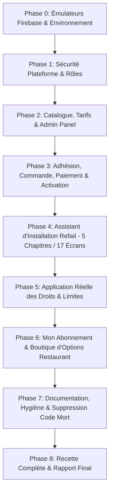

# RestoMaster OS — Plan Directeur d'Ingénierie ECC : Installation & Abonnements

> **Branche de travail** : `feature/installation-abonnements`  
> **Méthode** : Cycle ECC en 6 étapes (Plan $\rightarrow$ Test $\rightarrow$ Implement $\rightarrow$ Review $\rightarrow$ Verify $\rightarrow$ Remember) avec un commit par phase.  
> **Source unique de vérité** : `shared/catalog/` (`packs.ts`, `pricing.ts`, `resolver.ts`).

---

## Vue d'Ensemble & Découpage par Phase

---

## Détail des Phases & Livrables

### Phase 0 — Émulateurs Firebase et Hygiène de Développement
- [x] Implémentation et validation des fondations `shared/catalog/` (`packs.ts`, `pricing.ts`, `resolver.ts`, `catalog.test.ts`).
- [ ] Ajout de la section `emulators` dans `firebase.json` (Auth: 9099, Firestore: 8080, Functions: 5001, UI: 4000).
- [ ] Ajout du script `emulators:start` dans `package.json`.
- [ ] Connexion conditionnelle aux émulateurs dans `src/lib/firebase.ts` et `admin-panel/src/lib/firebase.ts` UNIQUEMENT si `VITE_USE_EMULATORS === 'true'`.
- [ ] Sécurité de build : `scripts/check-build-env.ts` refuse le build de production si `VITE_USE_EMULATORS` est activé.
- [ ] Documentation dans `docs/BUILD.md` (fonctionnement sous émulateurs sans forfait Blaze, plan d'activation Blaze ultérieur avec plafonds de budget).

### Phase 1 — Sécurité Plateforme (Bloquant)
- [ ] Règles Firestore `firestore.rules` :
  - Collection `platform_admins` : écriture (`create`/`update`/`delete`) réservée exclusivement à `platform_owner` (`request.auth.token.platformRole == 'platform_owner'`). Suppression formelle du droit de création par `superadmin` ou utilisateur standard.
- [ ] `admin-panel/src/context/AdminAuthContext.tsx` :
  - Accès au panneau d'administration conditionné STRICTEMENT par le custom claim `platformRole` (`platform_owner`, `platform_admin`, `support`, `billing`).
  - Suppression de tout fallback permissif sur `users/{uid}` ou rôle `superadmin`/`direction`.
  - Contrôle réel du second facteur (`mfaEnabled` lu depuis les données Auth réelles).
- [ ] Rôles & Provisioning (`functions/src/modules/provisioning.ts`) :
  - Le créateur/propriétaire d'un restaurant reçoit le rôle `direction` avec le flag `setupOwner: true` (JAMAIS `superadmin`).
  - Harmonisation des contrôles dans `App.tsx`, `AdminCenterView.tsx`, règles Firestore.
  - Rédaction de l'ADR sur la hiérarchie des rôles dans `docs/DECISIONS.md`.
- [ ] Contrôle d'accès des Tenants (`functions/src/auth.ts`, `assertTenantActive`) :
  - Refus immédiat si document `tenants/{orgId}` absent (zéro fail-open).
  - Matrice stricte des états autorisés : `installation` (configuration seule, vente bloquée), `paiement_en_attente`, `paiement_a_verifier`, `impaye` (grâce 7 jours puis lecture seule 30 jours), `suspendu`, `resilie`.
- [ ] Confidentialité des données internes de la plateforme :
  - Déplacement de `internalNotes`, `labels`, `healthScore` vers `tenants/{orgId}/admin/private` (lecture/écriture réservées aux administrateurs plateforme).
- [ ] Sécurisation du flux d'inscription temporaire (`submitSignup`).

### Phase 2 — Catalogue, Tarifs et Panneau Admin
- [ ] Structure Firestore : collections `catalog/packs`, `catalog/types`, `catalog/addons`, `catalog/settings`, `catalog_versions`.
- [ ] Script `scripts/seed-catalog.ts` alimenté par `shared/catalog/` avec mode `--dry-run` par défaut.
- [ ] Fonctions Cloud v2 :
  - `computeQuote` : devis certifié serveur avec lignes, totaux HT/TVA/TTC, mensualisation et suggestions de surclassement.
  - `updateCatalog` : mise à jour sécurisée du catalogue réservée à `platform_owner` / `platform_admin` avec validation de cohérence (multiples de 500, sans orphelins).
- [ ] Script de migration `scripts/migrate-plans.ts` (`plan_starter` $\rightarrow$ `minimum`, `plan_pro` $\rightarrow$ `medium`, `plan_enterprise` $\rightarrow$ `premium`) avec conservation du `priceSnapshot`.
- [ ] Panneau Admin (`admin-panel`) — Nouvel onglet « Catalogue & Tarifs » :
  - Gestion des 3 packs, des 8 types de restaurants avec matrice des modules par palier, options à la carte, réglages généraux, codes promos et simulateur de devis temps réel.
- [ ] Fiche Restaurant — Onglet « Abonnement » :
  - Affichage du pack, cycle, options, remises avec motif obligatoire, prolongation, bascule vers licence à vie, mise à jour automatique via `resolveEntitlements`.

### Phase 3 — Adhésion, Validation, Paiement et Activation
- [ ] 3.1 Demande d'adhésion : fonction Cloud `submitAdhesionRequest` (création compte Auth, vérification email exigée, sélection parmi les 8 types, sans choix de pack à ce stade).
- [ ] 3.2 Validation Admin : écran `SignupsListView` avec détection de doublons (email, téléphone, NIU), approbation créant le tenant en état `installation` sans droit d'exploitation.
- [ ] 3.3 Installation : l'assistant se lance pour le propriétaire (`setupOwner`).
- [ ] 3.4 Commande d'abonnement : fonction Cloud `submitSubscriptionOrder` générant un numéro de commande séquentiel lisible `RM-AAAA-NNNNNN` avec expiration à 7 jours.
- [ ] 3.5 Interface de Paiement : `PaymentProvider` (mode manuel Mobile Money Orange / MTN et virement) + fonction `markPaymentSent` (passage à l'état `paiement_a_verifier`).
- [ ] 3.6 Validation du paiement Admin : écran « Paiements à valider » avec contrôle de montant et référence unique (`validateSubscriptionPayment` / `rejectSubscriptionPayment`).
- [ ] 3.7 Activation transactionnelle idempotente `activateSubscription` : création de `subscription/current`, facture plateforme `platform_invoices`, calcul des droits via `resolveEntitlements`, audit immuable.
- [ ] 3.8 Cycle de vie planifié (`dailySubscriptionCheck`) : relances, période de grâce (7 jours), lecture seule (30 jours), gel de version pour licence à vie impayée en maintenance.
- [ ] 3.9 Notifications : collection `notification_queue` et modèles formels (demande reçue, approuvée, paiement, activation, échéance).
- [ ] 3.10 Bandeau de statut `TenantStatusBanner` et annonces plateforme.

### Phase 4 — Refonte Totale de l'Assistant d'Installation (Style OS Setup)
- [ ] Remplacement de `OnboardingWizard.tsx` par l'architecture modulaire `src/components/setup/` :
  - `SetupShell.tsx`, `SetupRail.tsx`, `SetupFooter.tsx`, `setupEngine.ts`, `quoteService.ts`.
  - 17 écrans répartis en 5 chapitres (aucun fichier $> 400$ lignes) :
    1. **Bienvenue** (Accueil & langue, Vérifications système/réseau).
    2. **Votre activité** (8 types illustrés, Nom & adresse, Identité légale, Modes de fonctionnement).
    3. **Votre abonnement** (Choix du Pack Minimum/Médium/Premium pour le type choisi, Options à la carte avec total dynamique, Récapitulatif devis & Paiement).
    4. **Votre installation** (Salle & tables réutilisant VectorFloorPlan, Caisses & paiements, Matériel & test d'impression, Carte & menus, Équipe & PINs).
    5. **Mise en service** (Contrôle "prêt à livrer", Code restaurant RMS-XXXX-XXXX sécurisé, Félicitations & lancement).
- [ ] Persistance et reprise dans `setup_sessions/{id}`, mode hors-ligne résilient.
- [ ] Ergonomie : cibles tactiles $\ge 44$ px, texte $\ge 14$ px, transitions douces, responsive tablette et mobile.

### Phase 5 — Application Réelle des Droits et des Limites
- [ ] Client : `isModuleEntitled` et `isFeatureEntitled` avec refus par défaut. Encapsulation par `FeatureGate` et page d'invitation à souscrire.
- [ ] Masquage automatique des onglets non souscrits dans `Sidebar.tsx` et `AdminCenterView.tsx`.
- [ ] Fonctions Cloud : assertions `assertFeature` / `assertModule` et plafonds stricts (utilisateurs, terminaux, commandes mensuelles, établissements).
- [ ] Règles Firestore : verrouillage en écriture sur les collections des modules non souscrits.

### Phase 6 — Côté Restaurant : Mon Abonnement & Boutique d'Options
- [ ] Page « Mon abonnement » : récapitulatif complet, cycle, échéance, prochaine maintenance pour licence à vie, factures PDF téléchargeables.
- [ ] Boutique d'options intégrée : catalogue dynamique selon le profil, suggestion du pack supérieur, commande d'option avec prorata.

### Phase 7 — Qualité, Documentation et Hygiène
- [ ] Réécriture de `docs/PLAN-CONFIGURATION-INITIALE.md`.
- [ ] Création de `docs/ABONNEMENTS.md` et mise à jour de `docs/DECISIONS.md`, `docs/RUNBOOK.md`, `docs/ADMIN-PANEL.md`.
- [ ] Suppression du code mort (`DEFAULT_PLANS`, `getPlanLimits`, anciens identifiants).
- [ ] Mise à jour du script `scripts/check-no-demo.ts`.

### Phase 8 — Recette sur Émulateurs & Rapport Final
- [ ] Validation des 13 scénarios de test critiques.
- [ ] Production du rapport `docs/RAPPORT-ABONNEMENTS.md` avec preuves tangibles.
